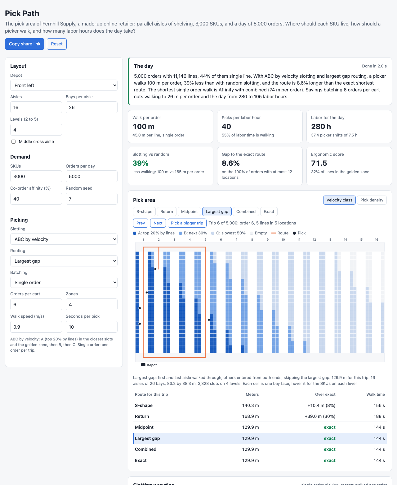

# Pick Path

A browser tool for warehouse slotting and order picking: where each SKU should live in a pick area, how a picker should walk a pick list, and what the day costs in meters and labor hours. It generates the pick area of Fernhill Supply, a made-up online retailer: 16 parallel aisles of shelving with 26 bays per side and 4 levels (3,328 slots), 3,000 SKUs with Pareto demand, unit sizes, and product families that are often ordered together, two days of order history, and a new day of 5,000 orders (11,146 lines). It slots the SKUs four ways (random, ABC, cube per order index, and affinity clustering of the co-order graph) under slot capacity limits, routes every order with five classic heuristics (S-shape, return, midpoint, largest gap, combined) and with the exact shortest route, then compares single order picking, seed and savings batching, and zone picking in labor hours.



## Why

In a manual pick area, walking is about half of all labor time, so the two cheapest levers in a fulfillment center are where the fast movers sit and how the pick lists are built and walked. Both are easy to get wrong without numbers: ABC slotting is common but coarse, "go up and down every aisle" is what pickers do when nobody tells them otherwise, and batching looks free until the sorting time at the cart is counted. This puts the decisions on one synthetic day so their effect on meters and hours can be compared directly, and measures each routing heuristic against the exact shortest route.

Results for the default day (seed 7, 0.9 m/s, 10 s per pick; meters walked per order, single order picking):

| Slotting | S-shape | Return | Midpoint | Largest gap | Combined | Pair distance |
|---|---|---|---|---|---|---|
| Random | 173.3 | 173.1 | 165.4 | 165.3 | 162.0 | 48.9 m |
| ABC by velocity | 104.5 | 97.8 | 100.5 | 100.2 | 93.8 | 23.7 m |
| Cube per order index | 117.3 | 112.5 | 111.7 | 111.6 | 104.6 | 27.0 m |
| Affinity | 89.0 | 75.8 | 85.2 | 85.2 | **73.6** | 6.3 m |

Pair distance is the average walk between the 200 SKU pairs ordered together most often.

| Picking method (ABC, largest gap) | Trips | m per order | Picks per labor hour | Labor hours |
|---|---|---|---|---|
| Single order | 5,000 | 100.2 | 40 | 280 |
| Seed batching, 6 per cart | 840 | 33.7 | 95 | 118 |
| Savings batching, 6 per cart | 858 | 25.6 | 106 | 105 |
| Zone picking, 4 zones, 6 per trip | 1,170 | 33.3 | 82 | 135 |

What the default day shows:

- **Slotting is worth more than routing.** Moving from random to ABC slotting cuts walking by 39% with largest gap routing. The best routing change on ABC slotting (largest gap to combined) is worth 6%.
- **The affinity win is mostly not about affinity.** Affinity slotting walks 15% less than ABC, but with co-order affinity set to 0% it still walks 15% less (82.8 vs 97.4 m). The affinity rule places clusters in strict order of pick density, and with few co-order edges that becomes a full velocity ranking, while ABC is random inside each class. Co-ordered pairs do end up much closer (6 m apart instead of 24 m), but 45% of orders are single line and most others have two lines, so it barely shows in route length here. It would matter more with larger orders or with batching on co-ordered items.
- **Heuristics are close to the exact route on small orders.** On ABC slotting, combined is 1.6% over the exact route in total and walks the exact route on 92% of orders; return is 6.0% over, largest gap 8.6%, S-shape 13.2%. With the fast movers near the front, S-shape loses because it walks every aisle to the end. The exact route covers all but 3 of the 5,000 orders here (at most 12 distinct locations).
- **Batching is the biggest lever of all.** Six orders per cart cuts labor from 280 hours to 118 with seed batching or 105 with savings batching. Savings batching beats seed batching by 11% in labor at about 10x the compute. Zone picking walks as little as seed batching but loses to it on hours, because of shorter trips and 30 s of consolidation for each order that spans zones.
- **The golden zone gain is small.** ABC raises the share of lines picked at waist to shoulder height only from 27% to 32%, because the fastest movers need a floor slot to hold a day of stock.

Other layouts: a center depot favors return and combined routing (ABC: 76.4 m per order with combined vs 91.6 m with largest gap). A middle cross aisle helps the traversal heuristics (largest gap on ABC: 100.2 to 95.7 m) and makes the simple heuristics worse relative to the exact route, because the multi-block versions here are simple ones (see below).

## How it works

```
 seed -> layout: aisles x bays x 2 faces x levels, slot capacity per level, depot on the front cross aisle
         catalog: SKUs with Zipf popularity (1 / rank), unit size (lognormal, median 1 L), product family
                                   |
   orders: 45% single line, mean 2.2 lines; later lines from an earlier line's family with p = affinity
   two days of history  ->  velocity, ABC classes, pick face volume, co-order graph
   one new day          ->  the day that is measured
                                   |
   slotting (capacity: one SKU per slot, volume fits, floor slots kept for bulky SKUs)
     random | ABC | cube per order index | affinity (greedy clustering of the co-order graph)
                                   |
   trips: single order | seed batching | savings batching | zone picking   (waves of 250 orders)
                                   |
   routes: S-shape | return | midpoint | largest gap | combined | exact (Held-Karp, up to 12 locations)
                                   |
   meters per order and line, labor hours, picks per labor hour, ergonomic score, gap to exact
```

- **Layout.** Aisles are 3 m wide with 1.1 m deep shelving on both sides, back to back between aisles, so aisle center lines are 5.2 m apart. Bays are 1.3 m. Cross aisles are 3 m wide at the front, at the back, and optionally in the middle. A picker walks the aisle center line and picks from both faces, so a pick location is (aisle, position along it). Levels from the floor up: floor (holds 150 L, 5 s extra to bend, ergonomic weight 0.6), two golden zone levels (60 L, 0 and 1 s extra, 1.0 and 0.95), high (60 L, 6 s, 0.55), top (60 L, 9 s, 0.35).
- **Distance.** Within an aisle, straight along it. Between aisles, along the first aisle to the best cross aisle, across, and along the second; one cross aisle is always enough. Tests check symmetry and the triangle inequality.
- **Demand and pick faces.** Slotting uses two days of history, and results are measured on a new day from the same demand, so slotting is not graded on the orders it was built from. A pick face holds one day of units (at least three units, at most a floor slot); about 100 SKUs need a floor slot.
- **Slotting.** Slots are ranked by seconds per visit: a walk there and back from the depot plus three times the reach or bend seconds (for fatigue and injury risk). ABC fills the ranking A class first, random inside each class. COI sorts by pick face volume over lines per day. Affinity merges co-order edges heaviest first into clusters of at most one three-bay section, places clusters by pick density, the fastest member in the best free slot and the others in the free slots closest to it. In every rule a small SKU may take a floor slot only while more floor slots are free than bulky SKUs still waiting, so every SKU fits.
- **Routing.** Single block: S-shape, return, midpoint, and largest gap follow the textbook definitions (Hall 1993; Roodbergen and de Koster 2001); combined is a dynamic program over the aisles in order, choosing for each aisle to walk through or to enter and turn back. With a middle cross aisle, the picker walks up the first aisle to the back of the farthest block with picks and clears blocks back to front, using the heuristic's rule inside each block; return enters every aisle from the front. These multi-block versions are simple adaptations, not the full Roodbergen and de Koster variants. The exact route is Held-Karp dynamic programming over the distinct pick locations with the shortest walking distances, up to 12 locations; a test checks it against brute force.
- **Batching.** Orders come in waves of 250. Seed batching seeds a cart with the order whose farthest pick is deepest and adds the orders that add the fewest new aisles. Savings batching is Clarke-Wright: savings of each order pair from the routing heuristic's route lengths, for each order's 30 nearest orders by pick centroid, merged heaviest first up to the cart size. Zone picking splits the aisles into groups; each zone picker starts at the front of the zone and picks its part of N orders per trip.
- **Labor.** Walking at the set speed, 10 s per pick plus the level's extra seconds, 60 s setup per trip, 3 s per line to sort into totes when a cart has more than one order, and 30 s consolidation per order picked in more than one zone. The conveyor in zone picking, replenishment, and packing are not costed.

The engine is `src/warehouse.js` with no DOM code. `src/run.js` runs the four slottings, the slotting x routing matrix with the exact route, the batching comparison, and a cart size sweep; `src/worker.js` runs it in a Web Worker and keeps the slotted problem so that changing only the slotting, routing, or batching choice takes about a second. Positions are rounded to centimeters so that routes compare exactly.

## What you see

- **The day** in a few sentences, and tiles for meters per order, picks per labor hour, labor hours and picker shifts, the gain over random slotting, the gap to the exact route, and the ergonomic score.
- **Pick area map**, top down, with every bay face colored by the velocity class of its fastest SKU or by today's pick density, the depot (or zone drop points), and the selected trip's route for any heuristic or the exact route. Step through trips or jump to a bigger one; a table compares every route for that trip.
- **Slotting x routing** matrix of meters per order. Click a cell to select it.
- **Routing heuristics** for the selected slotting: meters per order and line, gap to exact, share of orders where the heuristic is exact, picks per hour, and labor hours.
- **Batching and zones**: trips, meters per order, walking share, picks per hour, labor hours, and picker shifts for each method, and a chart of meters per order by cart size.
- **Where the labor goes**: walking, picking, and other hours per slotting, with ergonomics, golden zone share, and pair distance.

Layout, depot position, middle cross aisle, SKUs, orders, affinity, seed, slotting, routing, batching, cart size, zones, walking speed, and pick time are editable. All settings live in the URL hash, so a scenario can be shared as a link. Light and dark mode follow the system. Hover bay faces and chart points for details.

## Run it

It is a static site with no build step and no dependencies. ES modules need a web server, so `file://` will not work. From this folder run:

```bash
python3 -m http.server 8000
```

Then open http://localhost:8000. Adding `?noworker` to the URL runs everything on the main thread, which headless browsers need for screenshots.

## Tests

```bash
npm test        # or: node --test
```

40 tests cover the engine:

- RNG determinism, a problem reproducible from the seed, the Pareto shape and order sizes, affinity raising same-family pairs, and pick face volumes in range.
- Layout geometry, and the distance metric on hand-worked cases: same aisle, around the front or the back, through the middle cross aisle, from the depot. Symmetry and the triangle inequality on random points.
- For four layouts (depot left or center, with and without a middle cross aisle): every heuristic visits every pick, starts and ends at the depot, moves only along aisles and cross aisles, and reports its true length; the exact route is never longer than any heuristic. Held-Karp against brute force. The exact route skipped above 12 locations.
- S-shape, largest gap, return, and midpoint lengths on hand-worked examples, largest gap splitting, combined never longer than S-shape or return on a single block, and one-aisle orders equal for every heuristic.
- Every slotting placing every SKU once within slot capacity, floor slots kept for bulky SKUs, ABC putting the top movers nearest and raising golden zone picks, COI favoring small fast movers, clustering with a size cap, and affinity slotting putting co-ordered pairs closer and shortening their routes on a constructed case.
- Seed and savings batching covering every order once in carts of at most N within a wave, zone picking splitting lines across zones exactly once, batching cutting walking, labor hour math on a hand-built day, results adding up, a deterministic full evaluation, and config clamping and URL round trip.

## CI and deploy

`.github/workflows/ci.yml` runs `npm test` on Node 22 for every push and pull request. On push to `main` a second job publishes the site to GitHub Pages with `actions/upload-pages-artifact@v3` and `actions/deploy-pages@v4`. Set Pages to "GitHub Actions" as the source in the repo settings. The workflow has not been run locally.

## Production notes

- Slot from the warehouse management system's real order lines, SKU dimensions, and weights, re-slot weekly with a cap on moves per night (each move costs labor), and weigh slot changes against seasonality instead of re-slotting on yesterday.
- Route on the real floor plan as a graph (one-way aisles, blocked aisles, pallet locations, carts that cannot turn in narrow aisles), and use an exact or near-exact solver per pick list: at a few dozen picks a cheap solver beats any of the textbook heuristics.
- Batch inside the warehouse management system's wave or waveless release, with cart capacity in totes, volume, and weight, and with order due times, so urgent orders are not held for a full cart.
- Measure walk speed and pick times per picker and per location type from scan timestamps, and plan labor per hour of the day, not per day.
- Add replenishment: pick faces that hold one day of stock need a replenishment trip each night, and that labor moves when slotting changes.

## License

MIT. See [LICENSE](LICENSE).
